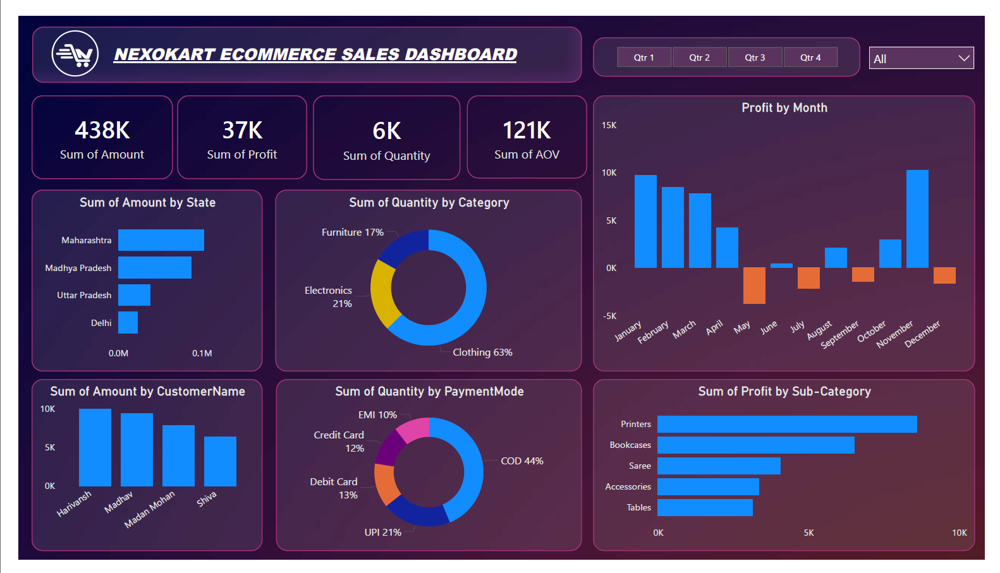

# 🛒 NexoKart E-Commerce Sales Dashboard
Interactive NEXOKART E-Commerce Sales Dashboard built using Power BI to analyze sales performance, profit trends, product categories, customer purchasing behavior, payment methods, and state-wise revenue. Provides actionable business insights through interactive visualizations and KPI tracking.

## 📌 About the Project

An interactive Power BI dashboard designed to analyze NEXOKART's e-commerce sales performance and generate actionable business insights. The dashboard provides a comprehensive overview of revenue, profit, quantity, average order value, customer purchasing patterns, and product category performance.

- How much revenue and profit are we making?
- Which months, categories and sub-categories drive (or hurt) profit?
- How do customers prefer to pay?
- Which states and customers contribute the most?

## 📊 Key Metrics

| 💰 Total Amount | 📈 Total Profit | 📦 Total Quantity | 🧾 AOV |
|:---:|:---:|:---:|:---:|
| **438K** | **37K** | **6K** | **121K** |

## ✨ Dashboard Features

- **Quarter slicer (Qtr 1 – Qtr 4)** and a **dropdown filter** that update every visual at once
- **Cross-filtering**: click any bar or donut slice to highlight related data across the page
- **KPI cards** for Amount, Profit, Quantity and AOV
- **Profit by Month** column chart, with loss-making months in a contrasting colour
- **Sales by State** and **Top Customers** bar charts
- **Category** and **Payment Mode** donut charts
- **Profit by Sub-Category** ranking
- Custom dark theme with gradient background and brand logo

## 🔍 Key Insights

<b>Click to expand / collapse</b>

- 👕 **Clothing dominates volume**: 63% of units sold, followed by Electronics (21%) and Furniture (17%).
- 💳 **Cash on Delivery is the most popular payment mode (44%)**, ahead of UPI (21%), Debit Card (13%), Credit Card (12%) and EMI (10%).
- 🗺️ **Maharashtra leads revenue**, followed by Madhya Pradesh, Uttar Pradesh and Delhi.
- 🖨️ **Printers and Bookcases are the most profitable sub-categories**, ahead of Saree, Accessories and Tables.
- 📅 **Profit is uneven across the year**: strong from January to April and again in November, with losses in May, July, September and December.
- 👤 **Top customers** (Harivansh, Madhav, Madan Mohan and Shiva) each contribute roughly 6K–10K in sales.

<b>💡 Recommendations</b>

- Investigate the loss-making months (May, July, September, December) for discounting or return issues.
- Promote UPI and card payments to reduce reliance on Cash on Delivery, which carries higher returns and handling risk.
- Expand marketing in lower-revenue states such as Delhi and Uttar Pradesh.
- Stock more of the high-profit sub-categories such as Printers and Bookcases.

##Lookin for custom dashboard let's

## 🗂️ Data Model

| Table | Description |
|---|---|
| **Orders** | Order-level data: order date, customer name, state |
| **Details** | Line-level data: category, sub-category, amount, profit, quantity, payment mode |

**Measures:** `Amount`, `Profit`, `Quantity`, `AOV`

## 🛠️ Tools & Skills

- **Power BI Desktop**: report design and interactivity
- **DAX**: calculated measures
- **Power Query**: data cleaning and transformation
- **Data modelling**: relating the Orders and Details tables
- **Data storytelling**: KPI cards, ranking charts and slicers

## 👤 Author
**Pranav Said** – <a href="https://linkedin.com/in/pranav-said-74a101286">LinkedIn</a> | <a href="https://github.com/pranavsaid34-bot">GitHub</a>

---

⭐ If you like this project, please give it a star! ⭐

